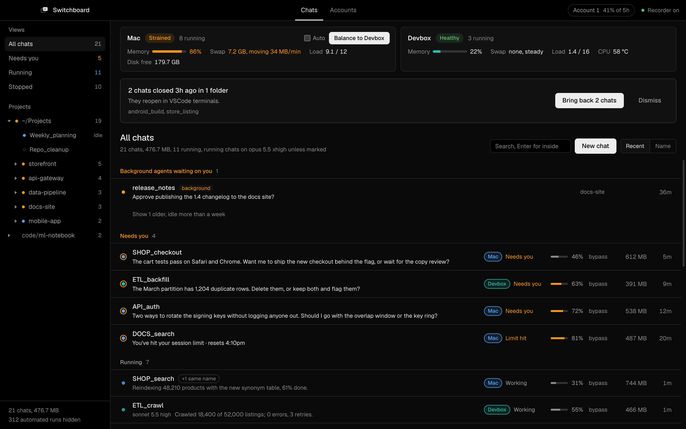
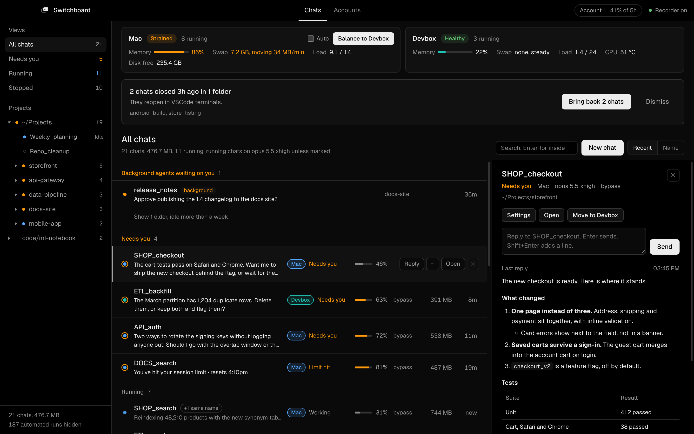
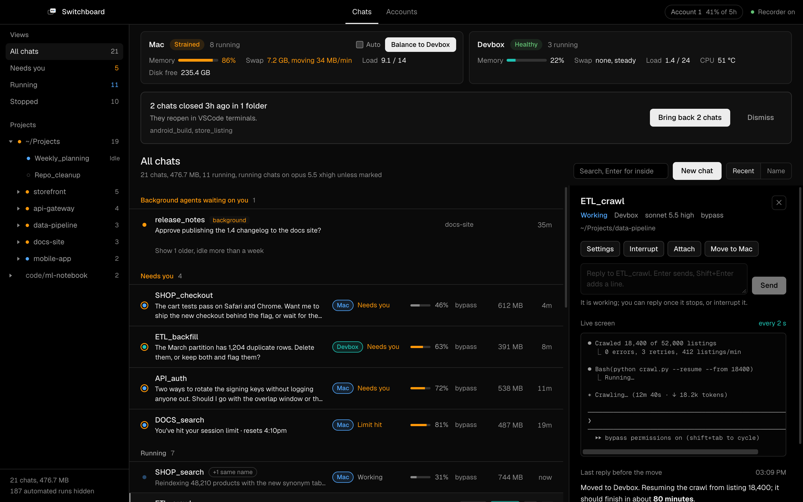
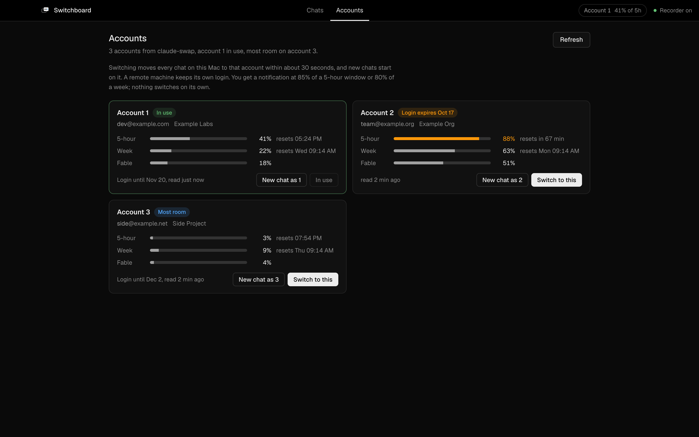
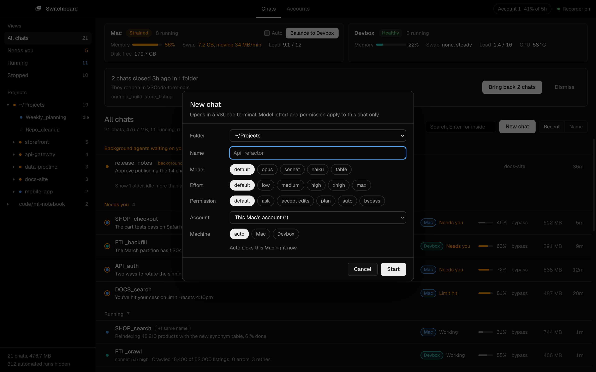

# Claude Switchboard

One window for every Claude Code chat you run, on every machine you own. It shows what each chat is doing and which ones are waiting on you, lets you reply to and steer them, brings them all back after a shutdown, and shares the work with a second computer when this one runs out of memory.

It is for people who keep many Claude Code chats open at once, mostly in VS Code terminals, and want the compute of a spare machine without babysitting two of them.

Two parts:
- **The app** (`src/`): a macOS window over all your chats and both machines.
- **Shared compute** (`tools/`, [docs/SHARED-COMPUTE.md](docs/SHARED-COMPUTE.md), [docs/LINUX-SETUP.md](docs/LINUX-SETUP.md)): how to install and set up a headless Linux box for Claude Code, with install scripts, a command-line tool that runs commands and chats there with your project synced both ways, a config and transcript sync, and an end-to-end test suite for your setup.

## What it does

**See every chat**
- One list of every chat on disk, grouped by project, with what each is doing: working, needs you, idle, stopped.
- Per chat: model and effort, context used, permission mode, memory held (the whole process tree, including its MCP servers), transcript size, and the last line it wrote.
- "Needs you" means the chat is idle and its last reply asks something, or Claude Code reports it waiting at a prompt. A working chat never counts.
- Chats that stopped on a usage limit or an API error are marked, with the reset time and a Continue button.
- Background agents (`claude --bg`) that are blocked on you are listed at the top.
- Groups: chats named with a shared prefix (`api_sync`, `api_ui`, `api_seo`) group together in the sidebar; drag a chat onto another group to refile it. A folder tree files each chat under the VS Code window it runs in. Chats that reuse one name fold under a single row, each copy labelled (current, latest, part of a continued chat, branch, older copy).
- Chats started in a folder that holds many projects are filed under the project their work actually touches.
- Full-text search: type, then press Enter to search what was written and replied in every chat.

**Bring them back**
- A recorder (a launchd job, about 90 ms every 30 s) remembers what was open. After a crash, an update or a power cut, one click reopens every chat, each in its own VS Code terminal tab.

**Steer them**
- Reply, or interrupt with Esc, from the window. Typing goes only into the terminal the chat runs in, and a reply waits until the chat is idle.
- Change a chat's model, effort or permission mode. The chat restarts idle with session-only launch flags, so your saved defaults and other chats stay as they are.
- New chat: pick a folder, name, model, effort, permission mode, account and machine.

**Share the work with a second machine (optional)**
- Configure an ssh-reachable Linux box that has tmux and Claude Code. The window shows both machines' memory, swap, pressure and load.
- Move a chat there, live: it closes cleanly, its project and transcript sync over, it resumes in tmux, and it reopens attached in the same VS Code tab. Move it back the same way.
- Balance moves idle chats off a strained Mac. Auto-balance, off by default, does it one chat at a time with checks. Both leave a chat that lately used what only this Mac has, such as its browser, a mounted drive or a Mac app.
- Watch a remote chat's live screen from the window.

**Accounts (optional)**
- With [claude-swap](https://github.com/realiti4/claude-swap) installed, an Accounts tab shows each account's 5-hour, weekly and per-model usage with reset times. It can switch accounts, or start a chat as a given account. A notification fires when an account passes 85% of its 5-hour window or 80% of its week; it never switches this Mac's account on its own.
- With claude-swap on the remote too, the recorder keeps the remote on this Mac's active account, or one of the same organization, so a moved chat stays on the account it ran on.

**Shared compute from the command line**
- `offload npm test` runs in the same folder on the remote, with files synced both ways by Mutagen and conflicts reported, never overwritten.
- `offload -d <job> <cmd>` for long jobs in tmux, `offload -p <port>` to reach a remote dev server, `offload claude <name>` and `offload attach <name>` for chats, `offload move <name>` to continue a closed chat there.
- `claude-sync` keeps the remote's Claude Code setup matching yours and brings its transcripts back.
- [docs/SHARED-COMPUTE.md](docs/SHARED-COMPUTE.md) covers the machine, Linux memory settings (zswap, the thrashing guard), Wi-Fi, ssh, logging in on the remote, tmux, notifications back over a locked-down key, and measured numbers: 40 idle chats in 6.1 GB on a 16 GB machine.

## Screenshots

Every name, path, account and number below is invented by `scripts/demo-overview.mjs`; none of it comes from a real machine.



A chat's detail panel: reply from the window, change its settings, open or move it, and read its last reply rendered.



A chat running on the second machine, with its live terminal screen refreshed every 2 seconds.







## Requirements

- macOS on Apple silicon. Tested on macOS 26.6; older versions are untested.
- Claude Code (the CLI), used in VS Code integrated terminals or any terminal. Tested with 2.1.301.
- [Bun](https://bun.sh) to build the app (tested with 1.4.2; it pulls in Electrobun 1.18).
- Node.js for the recorder (tested with 26.10).
- VS Code with the bundled bridge extension (`vscode-bridge/`), for opening, reopening and typing into terminals.
- Optional: a Linux machine reachable as an ssh host alias with key login, with `tmux`, `rsync` and Claude Code logged in. The app can map different home paths through config; `offload` needs the same paths on both machines. [Mutagen](https://mutagen.io) and `jq` on the main machine for `offload` and `claude-sync`.
- Optional: claude-swap (`cswap` on your PATH) for the Accounts tab.

## Install

```sh
git clone https://github.com/akv2011/claude-switchboard.git
cd claude-switchboard
bun install
npm test                 # node --test, 190 tests, no network
npm run bridge           # packages and installs the VS Code extension
bun run gui              # builds build/stable-macos-arm64/Claude Switchboard.app
scripts/install.sh       # copies the app to /Applications, installs the recorder, opens it
```

The first run asks nothing. Arm the recorder from the title bar (Recorder off, then Arm).

## Configuration

Everything is optional. Without a config file the app runs on this Mac only and never starts ssh. See [docs/CONFIG.md](docs/CONFIG.md) for every key.

```json
{
  "remote": { "host": "devbox", "label": "Devbox", "projectsRoot": "~/Projects" },
  "projectsRoots": ["~/Projects", "~/code"]
}
```

Save it as `~/.config/claude-switchboard/config.json`.

## Privacy and safety

- It reads Claude Code's own files under `~/.claude` (transcripts, the session registry, background job state) and nothing else of yours.
- It writes only under `~/.claude-switchboard` (cache, recorder snapshot, request files for the VS Code bridge) and its launchd job. Only if the bridge extension is missing does a restore fall back to writing a VS Code `tasks.json` in the project folder.
- It never calls a model and never uses an API key. Account usage comes from claude-swap's local cache.
- Deleting a chat moves its transcript to the macOS Trash; nothing is erased.
- Remote features use your own ssh config. Config values that reach ssh, rsync or tmux are validated first (see [SECURITY.md](SECURITY.md)).

## Troubleshooting

- **Reply says no VS Code window has the terminal.** The chat runs outside VS Code, or the bridge is not installed (`npm run bridge`). Chats in other terminals can still be watched, moved and restarted.
- **The remote card says unreachable.** Check `ssh <host> true` works without a password prompt. The app uses `BatchMode=yes`.
- **A chat started from the app saves no transcript.** VS Code was opened from inside a Claude Code session and passed its markers on. Open VS Code normally; chats the app starts strip those markers.
- **The recorder says broken.** It reports launchd's last exit reason; `scripts/install.sh` reinstalls it.

## Limitations

- macOS only for the main machine; the remote must be Linux with tmux.
- Live screens and keystrokes for chats on the Mac work only for chats in VS Code terminals.
- A chat open on two machines at once forks its transcript. The app avoids that when it moves chats, but cannot stop you starting one by hand.

## Documentation

- [docs/SHARED-COMPUTE.md](docs/SHARED-COMPUTE.md): setting up a second machine and sharing the work.
- [docs/LINUX-SETUP.md](docs/LINUX-SETUP.md): installing that machine from a blank disk, with `tools/linux-setup/`.
- [docs/ARCHITECTURE.md](docs/ARCHITECTURE.md): modules, data flow, the RPC surface, the bridge protocol.
- [docs/CONFIG.md](docs/CONFIG.md): every setting.
- [CONTRIBUTING.md](CONTRIBUTING.md), [SECURITY.md](SECURITY.md), [CHANGELOG.md](CHANGELOG.md).

## License

MIT. See [LICENSE](LICENSE).
